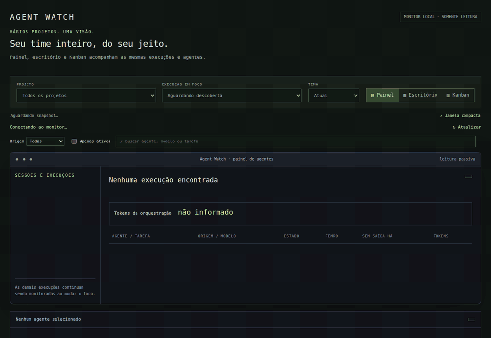
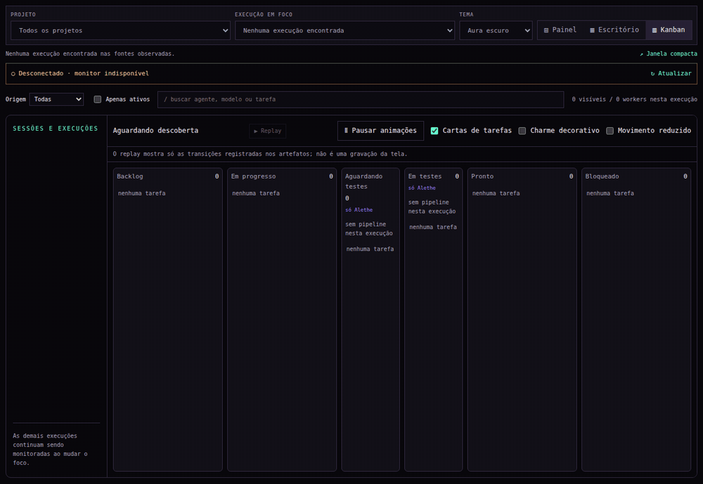

# Agent Watch

**Visualizador local de orquestrações de agentes de IA.** O Agent Watch mostra quem está trabalhando, em qual tarefa, quem delegou para quem e o que já foi entregue, sem interferir nos agentes. Ele lê os artefatos que as ferramentas de orquestração já gravam em disco e os apresenta em três visões da mesma execução:

- **Painel:** agentes, tarefas, saídas, erros e consumo de tokens.
- **Escritório:** uma sala visual em que delegações e entregas aparecem como eventos comprovados.
- **Kanban:** cada tarefa na coluna que os artefatos comprovam, com replay das transições.

Também há uma interface de terminal. Hoje ele acompanha a **Alethe** e os subagentes nativos do **Claude Code** e do **Codex**; outras fontes podem ser acrescentadas com um leitor novo (veja [Como funciona](#como-funciona)).





*Demonstração com dados fictícios (`--demo`). Nenhum agente ou modelo foi iniciado para produzir as imagens. Capturas estáticas: [Escritório](docs/images/office.png) · [Painel](docs/images/panel.png) · [Kanban](docs/images/kanban.png).*

## O que ele acompanha hoje

| Fonte | O que aparece | Por que funciona |
| --- | --- | --- |
| **Alethe** | Orquestrações completas: ondas, workers de qualquer CLI (Codex, Claude Code, Agy, Kimi ou customizado), funções Planner, Developer, Reviewer e QA, revisões e decisões dos gates do pipeline | A Alethe grava em disco o plano, o estado e o resultado de cada onda e de cada worker, a tarefa enviada e as decisões dos gates (`plan.json`, `state.json`, `outcome.json`, `prompt.txt`, `gate-NN.json`) |
| **Claude Code** | Subagentes nativos e o agente que os criou, com tarefa, estado, saída pública e tokens | O Claude Code registra cada sessão em JSONL, com a chamada de ferramenta que criou o subagente e o resultado devolvido |
| **Codex** | Subagentes nativos ligados à sessão de origem, com início, conclusão e tokens | O Codex registra as sessões em JSONL, com `thread_spawn` e `parent_thread_id` ligando cada subagente ao seu pai |

Quando um worker da Alethe é uma sessão do Claude Code ou do Codex, o monitor reconhece a mesma sessão nas duas fontes e mostra um agente só.

**Fora do alcance hoje:** outros orquestradores (servidores de agentes, LangGraph, CrewAI, SDKs de agentes em código próprio), CLIs usados sozinhos fora da Alethe e sessões remotas ou na nuvem sem histórico local. Para eles, falta um leitor; o restante do monitor já está pronto para recebê-los.

## Como funciona

1. **Leitura passiva.** O monitor só lê os arquivos que as ferramentas já produzem. Ele não inicia, retoma nem interrompe agentes, não instala hooks, não altera configurações e não chama modelos. A leitura é incremental: arquivos grandes são lidos pela cauda, linhas incompletas são esperadas e um arquivo corrompido não derruba os demais.
2. **Um leitor por fonte.** Cada formato tem um leitor em `src/alethe_tui/adapters/`. Ele traduz o que encontra para um contrato comum: **agentes** (quem, função, modelo, estado, tarefa), **execuções** (projeto, líder, início), **eventos** (delegou, começou, resultado disponível, resultado entregue, falhou) e, quando existem, **gates** do pipeline.
3. **Evidência antes de tudo.** Cada estado e cada interação guarda o arquivo e o fato que o comprovam. Sem evidência, o estado aparece como **não confirmado**: silêncio não é travamento, e concluir um turno não prova que o resultado chegou ao líder. O raciocínio interno dos modelos nunca é exibido.
4. **Correlação.** O monitor junta as fontes a cada segundo: agrupa execuções por projeto (inclusive worktrees do mesmo repositório), une a mesma sessão vista por fontes diferentes e decide a coluna de cada tarefa no Kanban.
5. **Mesmo snapshot para todas as interfaces.** Painel, Escritório, Kanban e TUI consomem o mesmo snapshot por um servidor local autenticado. Trocar de visão não inicia outra coleta.

**Acompanhar outra fonte** é escrever um leitor que devolva o mesmo contrato. A fonte precisa expor, em algum lugar legível localmente, ao menos a identidade de cada agente, a execução a que pertence e o seu estado; quem delegou para quem é desejável. As interfaces funcionam sem mudança.

## Recursos

- Vários projetos e execuções simultâneos, com seleção preservada entre Painel, Escritório e Kanban.
- Pastas de projetos configuráveis por `.env`, incluindo mais de um diretório.
- Identificação de função, onda, tarefa, modelo e effort quando informados pelas fontes.
- Tarefas completas sob demanda, além de saída, resultado e erro por agente.
- Tokens por agente e total da orquestração, com indicação de consumo parcial.
- Escritório com todos os agentes filtrados, crescimento vertical e animações por eventos comprovados.
- Kanban com as colunas Backlog, Em progresso, Aguardando testes, Em testes, Pronto e Bloqueado, cartões que se movem como se fossem arrastados e **Replay** resumido das transições registradas.
- Listas laterais com paginação automática, limitadas à altura de cada apresentação.
- Temas **Atual**, **Aura escuro** e **Claro**, janela compacta e opções de movimento reduzido.

## Requisitos

- Linux ou WSL para os scripts de execução e controle em segundo plano.
- Python **3.11 ou superior** e [`uv`](https://docs.astral.sh/uv/).
- Navegador para a interface gráfica; terminal interativo para a TUI.
- Artefatos locais de execução para acompanhar agentes reais. O modo de demonstração funciona sem eles.

## Início rápido

Clone o repositório e prepare o ambiente:

```sh
git clone https://github.com/jonathangentil/agent-watch.git
cd agent-watch
uv sync --extra dev
cp .env.example .env
```

Edite o `.env` com as pastas que contêm seus projetos:

```dotenv
AGENT_WATCH_PROJECT_DIRS='["~/projects", "~/agents", "/mnt/c/meus projetos"]'
```

Depois, abra a interface desejada:

```sh
./run.sh --web --office         # Escritório no navegador
./run.sh --web                  # Painel no navegador
./run.sh --web --kanban         # Kanban no navegador
./run.sh                       # TUI no terminal
./run.sh --web --office --demo  # Somente dados fictícios, sem chamadas a modelos
```

Os comandos `uv run agent-watch` e `uv run alethe-tui` também estão disponíveis, com as mesmas opções.

`Ctrl+C` encerra o servidor gráfico iniciado no terminal; `q` fecha a TUI. Os agentes monitorados continuam trabalhando.

## Monitor em segundo plano

```sh
./service.sh start              # Inicia na porta 3010 e abre o Escritório
./service.sh open               # Abre a sessão atual no navegador
./service.sh status             # Mostra estado, PID e porta
./service.sh stop               # Encerra somente o monitor
```

Fechar o navegador ou o terminal não encerra esse serviço. Repetir `start` reutiliza a instância existente. O monitor não inicia automaticamente após reiniciar a máquina ou encerrar o WSL.

```sh
./service.sh start --no-open    # Inicia sem abrir o navegador
./service.sh start --port 8765  # Usa outra porta; encerre a instância anterior primeiro
```

No WSL, a abertura usa o navegador padrão do Windows via PowerShell, quando disponível.

O acesso inicial exige a URL de sessão exibida pelo aplicativo. Para reabrir o serviço, prefira `./service.sh open`: digitar apenas `localhost:3010` não autoriza o navegador. A autorização é específica do endereço, portanto `localhost` e `127.0.0.1` não compartilham o cookie.

## Configuração

### Pastas de projetos

`AGENT_WATCH_PROJECT_DIRS` aceita uma lista JSON com um ou mais diretórios. São exibidos os projetos dentro de qualquer uma dessas pastas, incluindo projetos em subdiretórios. Caminhos com espaços e `~` são aceitos.

- `[]` ou ausência da variável mantém todos os projetos descobertos nas fontes.
- Uma variável exportada no ambiente tem prioridade sobre o `.env`.
- O `.env` é lido no início, a partir da pasta de trabalho. Os scripts usam a pasta do Agent Watch.
- Após editar o arquivo, reinicie o monitor.

O `.env` local fica fora do Git; o modelo versionado é [.env.example](.env.example).

### Fontes de execução

| Fonte | Local padrão | Variáveis respeitadas |
| --- | --- | --- |
| Alethe | `~/.config/alethe/orchestrations` | `XDG_CONFIG_HOME`, `ALETHE_ORCHESTRATE_POLICY`, `ALETHE_ORCHESTRATE_HOME` |
| Claude Code | `~/.claude/projects` | `CLAUDE_CONFIG_DIR` |
| Codex | `~/.codex/sessions` | `CODEX_HOME` |

As pastas de projetos definem o recorte exibido. Os artefatos de agentes são descobertos nas fontes acima; apontar uma pasta de projetos não substitui a configuração dessas fontes.

Para acrescentar raízes ou informar outros locais:

```sh
./run.sh --root /outra/raiz/alethe --root /mais/uma/raiz
./run.sh --claude-root /pasta/projects --codex-root /pasta/sessions
./run.sh --web --no-open --port 8765
```

Também é possível persistir opções em `~/.config/alethe-tui/config.toml`:

```toml
roots = ["/outra/raiz/alethe", "/mais/uma/raiz"]
interval = 1.0
verify_pids = true
```

Use `--no-pid-check` para fontes copiadas de outra máquina. Uma raiz personalizada desconhecida precisa ser cadastrada; o monitor não varre todo o disco.

## Usando as interfaces

**Painel:** selecione projeto, execução e agente. A linha inteira seleciona o agente; as abas mostram **Saída**, **Tarefa**, **Resultado** e **Erro**. O total de tokens usa os agentes da execução e não diminui ao filtrar a tabela por origem, estado ou busca.

**Escritório:** clique em um personagem para consultar seus detalhes. Passe o mouse sobre ele para ver modelo, effort, onda e tarefa. Todos os agentes filtrados ficam na mesma sala; a lista lateral de execuções tem paginação própria.

**Kanban:** mostra as tarefas da execução em foco. Clique em um cartão para abrir os detalhes, com a evidência que coloca a tarefa naquela coluna; `Esc` ou **Fechar detalhes** recolhe o painel. Clique no testador para consultar o Reviewer ou o QA. **▶ Replay** reproduz as transições registradas em lotes, com pausa de até 0,5 s entre eles, nas velocidades 1×, 2× e 4×, com barra de posição e relógio no horário real; **Voltar ao vivo** retorna ao quadro atual.

**TUI:** `Tab` muda o foco, `/` busca, `a` alterna agentes ativos, `l` alterna detalhes, `f` alterna acompanhamento da saída, `r` atualiza, `o` abre o Escritório, `p` abre o Painel e `q` sai.

Alterar a apresentação preserva o contexto. As preferências de tema ficam salvas no navegador para o mesmo endereço local; uma porta fixa permite reutilizá-las entre reinícios.

## Como interpretar os dados

- **Função e tarefa:** Planner, Developer, Reviewer ou QA substituem o nome quando há atribuição explícita. O identificador original e a onda são preservados. Na Alethe, a tarefa é recuperada do `prompt.txt` do worker; o snapshot contém um resumo e a consulta completa é limitada a 64 KiB.
- **Tokens:** são valores informados pelas fontes, incluindo cache quando disponível, sem contar novamente cache que já integra a entrada. Ausência significa **não informado**, não zero. Falta de medição, histórico incompleto ou consumo desconhecido do líder torna o total **parcial**. O orçamento da Alethe pode usar outra base, separando leituras de cache.
- **Estado:** silêncio não comprova travamento. Conclusão de turno não comprova encerramento da sessão nem entrega do resultado ao líder. Sem evidência suficiente, o estado fica **não confirmado**.
- **Kanban:** cada worker vira um cartão, exceto o líder; Reviewer e QA de um pipeline da Alethe aparecem como testadores dentro do cartão do Developer. As colunas de teste dependem dos contratos, revisões e `gate-NN.json` do pipeline da Alethe; nas demais fontes, a tarefa vai de Em progresso para Pronto. Antes do gate, o vínculo com o testador é deduzido pela onda; o gate o confirma. Pronto sem evento de entrega mostra **entrega não comprovada**. O replay mostra só transições registradas, sem gravação de tela, e omite nos cartões dados que dependem do momento, como testadores, selos, tempos e tokens.
- **Animações:** delegação, resultado disponível e resultado entregue são eventos distintos. O histórico inicial não é animado. O modo **Charme decorativo** é opcional e não representa comunicação real; pausar animações não pausa agentes.

No Escritório, **Cartas de tarefas** mostra um envelope seguindo a linha do remetente ao destinatário. Delegações enviam a carta ao agente; entregas de resultado comprovadas fazem o caminho de volta. Quando há somente conclusão, a carta com um visto aparece junto ao agente como resultado disponível, sem afirmar entrega ao líder. Cada evento anima até três vezes e a carta e a linha desaparecem. Atualizações e trocas de interface não repetem o evento. Desmarque a opção para ocultar imediatamente essas animações; a preferência fica salva no navegador, sem alterar estados ou histórico. Pausa e movimento reduzido também suprimem as cartas.

A descoberta depende de artefatos locais persistidos e dos formatos suportados. Sessões remotas sem histórico local e raízes personalizadas não cadastradas podem não aparecer.

## Privacidade e execução local

O servidor fica em `127.0.0.1`, com autenticação por sessão, e não envia os dados monitorados a serviços externos. O monitor não escreve em históricos, SQLite ou artefatos dos agentes e não exibe raciocínio interno.

Os arquivos de controle do serviço ficam em `${XDG_STATE_HOME:-~/.local/state}/agent-watch`, fora do repositório. O log contém a URL de autorização: mantenha-o privado.

## Desenvolvimento e testes

```sh
uv sync --extra dev
.venv/bin/python -m pytest
node --test tests/web/*.test.mjs
```

Os testes JavaScript usam o executor nativo do Node.js. Em ambientes que restringem subprocessos, execute cada arquivo diretamente:

```sh
for test_file in tests/web/*.test.mjs; do
  node "$test_file" || exit
done
```

A validação visual usa Playwright e Chromium disponíveis no ambiente. Informe seus caminhos e execute:

```sh
PLAYWRIGHT_MODULE=/caminho/playwright-core/index.mjs \
CHROMIUM_EXECUTABLE=/caminho/chromium \
node tests/web/browser-smoke.mjs
```

`tests/web/real-server-smoke.mjs` verifica a interface contra um servidor HTTP com fontes sintéticas. Os arquivos `tests/web/kanban-*smoke.mjs` sobem a demonstração e verificam no Chromium o quadro, o movimento dos cartões e o replay, usando as mesmas variáveis. Todos funcionam sem iniciar agentes ou chamar modelos.

A implementação Python fica em `src/alethe_tui/`; os arquivos da interface gráfica, em `src/alethe_tui/web/`. As duas interfaces consomem o mesmo contrato de snapshot.

Consulte o [estado da entrega](docs/STATUS.md) e o [roadmap](docs/ROADMAP.md).
